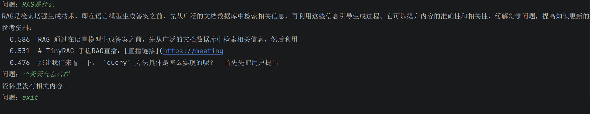

# 笔记问答机器人（RAG）

一个用命令行运行的小型 RAG（检索增强生成）项目：把 Markdown 资料切块、向量化后存成本地索引，提问时先检索最相关的片段，再让大模型**只根据这些片段**作答，并显示参考来源。资料里没有答案时，会直接回答"资料里没有相关内容"，不会凭空编造。

目前内置的知识库是 TinyRAG 教程（见文末"资料来源"），换成自己的 md 笔记也可以使用。

## 效果演示



## 工作流程

建索引（只需运行一次）：

1. **读取**：读入 md 文件，过滤掉对问答没有用的图片行。
2. **拆单元**：按空行分段；代码块整体算一个单元，不从中间拆开。
3. **合并成块**：把相邻的小单元攒到约 500 字符，避免出现孤零零的标题。
4. **拆超长块**：超过上限的块在行与行之间拆开，单行本身超长时才按固定长度硬切。
5. **向量化**：用 bge-m3 把每个块变成 1024 维向量。
6. **保存索引**：块原文、向量和模型名一起存进 `index.json`。

问答（每次提问）：

1. 把问题向量化（使用索引里记录的同一个模型）。
2. 用余弦相似度与所有块比较，取最相似的 3 个。
3. 把这 3 个块和问题拼成提示词，交给 DeepSeek，要求只根据资料回答。
4. 打印回答；如果回答不是"资料里没有相关内容"，同时打印参考资料及相似度分数。

## 技术栈

- Python 3.9 及以上（开发环境为 3.14）
- 向量化：`BAAI/bge-m3`，通过硅基流动（SiliconFlow）的 OpenAI 兼容接口调用
- 大模型：DeepSeek（`deepseek-flash`），同样通过 `openai` 库调用
- `numpy`：计算余弦相似度
- `python-dotenv`：从 `.env` 读取 API Key

## 项目结构

```
note_qa/
├── data/
│   └── tinyrag_readme.md   # 知识库资料
├── embeddings.py           # 向量化：BaseEmbeddings 基类 + SiliconFlowEmbedding
├── utils.py                # 读取与切块：read_markdown、split_blocks、merge_blocks、split_long、load_chunks
├── vector_store.py         # 索引：build_index、save_index、load_index，以及 cosine、search 检索
├── llm.py                  # 大模型：chat 调用 DeepSeek，answer 拼提示词并作答
├── build_index.py          # 建索引入口
├── main.py                 # 命令行问答入口
├── index.json              # 运行 build_index.py 后生成
├── requirements.txt
├── .env                    # API Key（不提交到仓库）
└── README.md
```

## 如何运行

1. 获取代码并进入项目目录：

   ```
   git clone https://github.com/povr26119-tech/rag-note-qa.git
   cd rag-note-qa
   ```

2. 创建虚拟环境并安装依赖：

   ```
   python -m venv .venv
   .venv\Scripts\activate        # macOS / Linux 使用：source .venv/bin/activate
   pip install -r requirements.txt
   ```

3. 在项目根目录新建 `.env`，填入自己的 Key：

   ```
   SILICONFLOW_API_KEY=你的硅基流动Key
   DEEPSEEK_API_KEY=你的DeepSeek Key
   ```

4. 建立索引（会调用向量化接口，只需运行一次；资料或切块方式改变后需要重新运行）：

   ```
   python build_index.py
   ```

5. 开始提问，输入 `exit` 退出：

   ```
   python main.py
   ```

## 设计要点

- **沿自然结构切块，而不是按固定字数硬切。** 按空行分段，代码块整体保留。一段代码被从中间劈开后，两半单独都读不懂，检索出来也没有用。
- **先拆再合。** 太短的单元合并成块，太长的块再拆开，让块的长度大致落在合适范围内。
- **超长内容有兜底。** 超长块先按行拆；某一行本身超长时再硬切，保证不会产生超出上限的块。
- **向量化时保留换行。** 换行是代码和列表的结构信息，保留下来，向量更贴近原文。
- **索引里记录模型名。** 不同模型算出的向量不能混用，查询时读取索引里的模型名，保证问题和资料用同一个模型。
- **用提示词约束回答。** 要求只根据资料作答，没有就回答固定的一句话；程序再根据这句话决定要不要显示参考来源，避免无关的来源误导读者。
- **模块分层，错误向上抛。** `chat` 只负责调用大模型，出错时把异常抛出，由 `main.py` 决定怎么提示用户，以后换成网页界面时，这一层可以直接复用。

## 已知不足与后续计划

已知不足：

- 还没有系统的评测集，检索效果目前只靠少量问题人工检查。
- 相邻块之间没有重叠，答案恰好跨在两个块之间时，可能只检索到一半。
- 第一个块混入了直播链接等对问答没有价值的内容。
- 长度按字符数而不是 token 数计算，是一个简化。
- "有没有答案"靠回答里的固定句子判断，模型换了说法就会失效。
- 检索是逐个计算相似度，资料量很小时没有问题，资料多了需要换成向量数据库。
- 目前只支持 md 文件和单轮问答。

后续计划：

1. 补上评测集，用命中率对比不同的切块大小、是否重叠、是否加相似度阈值。
2. 用 Streamlit 做网页界面并部署，拿到可访问的链接。
3. 做技术文档助手：支持多文件、多轮追问（追问需先改写成完整问题再检索）、回答中给出原文出处。

## 资料来源与许可

知识库资料 data/tinyrag_readme.md 取自 Datawhale 的开源教程 tiny-universe 中的 TinyRAG 教程（content/TinyRAG/readme.md），未作修改。

- 来源：https://github.com/datawhalechina/tiny-universe
- 作者：Datawhale 及原项目贡献者
- 许可证：CC BY-NC-SA 4.0（https://creativecommons.org/licenses/by-nc-sa/4.0/deed.zh-hans）

index.json 由上述资料切块、向量化后生成，属于对原资料的改编，同样按 CC BY-NC-SA 4.0 共享。上述资料及其衍生内容仅限非商业使用。本项目的代码部分与资料的许可相互独立。